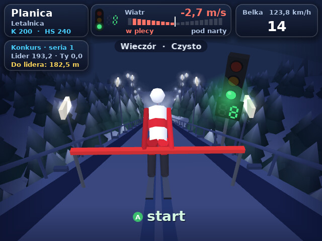
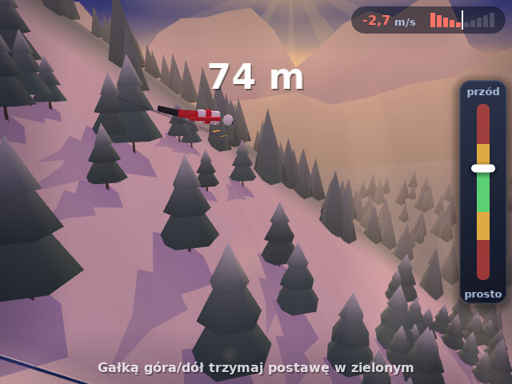
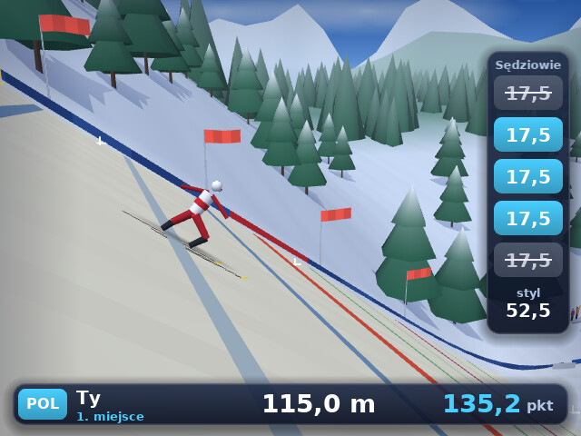
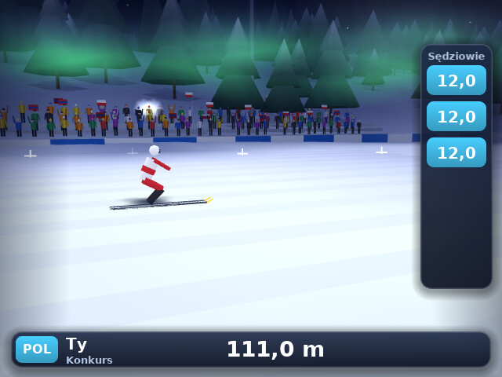
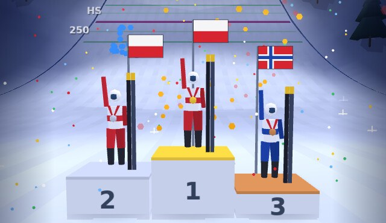
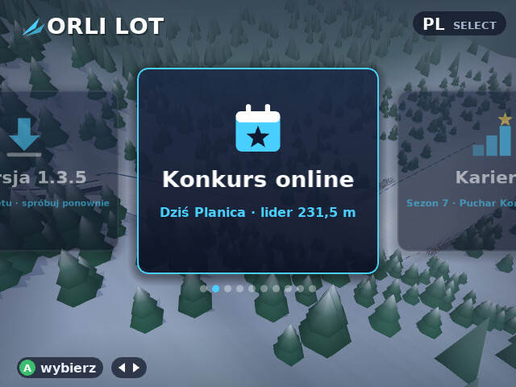

  

<h3 align="center">Skoki narciarskie w 3D na konsolkę R36S</h3>

  27 prawdziwych skoczni – od Karpacza po Planicę. Wybicie co do setnej sekundy, wiatr i pogoda, telemark, 
  noty sędziów jak w telewizji i codzienny konkurs online. Za darmo.

  
   
  zip · 294 KB · 05.11.2026 · <a href="https://github.com/sebastian-nni/orlilot/releases">wszystkie wersje</a> · <a href="https://sebastian-nni.github.io/orlilot/">strona gry</a>

<table>
  <tr>
    <td></td>
    <td></td>
  </tr>
  <tr>
    <td></td>
    <td></td>
  </tr>
  <tr>
    <td></td>
    <td></td>
  </tr>
</table>

## Jak wgrać

1. Pobierz **orli-lot-1.3.5-r36s.zip** (zielony przycisk wyżej albo [Wydania](https://github.com/sebastian-nni/orlilot/releases)).
2. Rozpakuj. W środku jest plik `Orli Lot.sh` i folder `orlilot`.
3. Wrzuć oba do folderu `ports` na karcie z grami.
4. Uruchom ponownie konsolę albo odśwież listę gier.
5. Wejdź w **Ports → Orli Lot**.

Sprawdzone na R36S z ArkOS i dArkOS. Kolejne wersje pobierzesz już w grze – karta **Wersja** w menu.

## Jak się skacze

1. **Zielone światło** – siadasz na belce, zegar odlicza 10 sekund. Wciskasz A i jazda.
2. **Wybicie** – A tuż przed progiem. Gra powie, czy było za wcześnie. Bez wybicia nie polecisz.
3. **Lot** – gałką trzymasz postawę w zielonym. Linia na zeskoku pokazuje, ile trzeba do lidera.
4. **Lądowanie** – gdy pierścień zrobi się zielony: B i A razem = telemark, jeden przycisk = dwie nogi.
5. **Noty** – pięciu sędziów, punkty za odległość, styl, wiatr i belkę. Gra pokaże, za co odjęli.

## Co jest w grze

- **7 trybów:** Konkurs online, Kariera, Zawody, Drużyny (14 krajów), Liga Światowa, Turniej Noworoczny i Trening z samouczkiem
- **27 skoczni:** Wielka Krokiew, Malinka, Bergisel, Letalnica i inne – od K85 do mamutów K200
- **Wiatr i belka:** wiatr zmienia się w trakcie skoku, w zawodach belkę ustawia jury
- **Pora i pogoda:** dzień, zachód, wieczór z reflektorami, mgła, śnieg, zawieja, czasem zorza
- **Konkurs online:** codziennie inna skocznia i wspólny ranking, punkty liczy serwer
- **Do 4 graczy** na zmianę na jednej konsoli
- Powtórki, rekordy skoczni, duch rekordu, podium z medalami
- 4 języki: polski, angielski, niemiecki, czeski

## Sterowanie

| Przycisk | Co robi |
|---|---|
| A | start z belki, wybicie, dalej |
| Gałka góra / dół | postawa w locie |
| B + A | telemark (jeden przycisk – dwie nogi) |
| ← → | belka w treningu, wybór karty w menu |
| X | powtórka po skoku |
| R1 | zapis powtórki |
| Start | pauza |
| Select | wróć, w menu głównym zmiana języka |
| Select + Start | wyjście z gry |

---

### English

**3D ski jumping for the R36S handheld.** 27 real hills, take-off timing to the hundredth of a second, wind and weather, telemark landings, TV-style judges' scores and a daily online contest. Free.

[Download orli-lot-1.3.5-r36s.zip](https://github.com/sebastian-nni/orlilot/releases/download/v1.3.5/orli-lot-1.3.5-r36s.zip), unzip it, put `Orli Lot.sh` and the `orlilot` folder in `ports` on your games card, restart the console (or refresh the game list) and go to **Ports → Orli Lot**. Tested on R36S with ArkOS and dArkOS. The game speaks Polish, English, German and Czech – press Select in the main menu to switch.

---

Autor: Sebastian Kowalski · 2026 · Gra niezależna, niepowiązana z FIS. Zawodnicy są zmyśleni.
